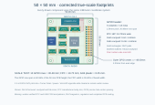

# ROV-GND-P4 Rev A — 50 × 50 mm square, all GH standing

**Hard requirement: 50 × 50 mm PCB outline.** This replaces the previous 80 mm target. The diagram is a **real-scale, preliminary physical packing study**. It is not a finished KiCad placement, routed PCB or confirmed assembled mechanical fit.

Print the SVG at its declared physical size with **100% scaling**: the board green outline should measure 50 × 50 mm.

## Edge and side strategy

- **North (top):** Camera 15-pin 1.0 mm CSI-2 FPC, cable exits north. **microSD is on the underside of the PCB with its card slot accessible at the north edge**; top CSI and bottom microSD exit at different heights. This two-sided overlap and any cover/cable access require physical testing.
- **West:** **Only the USB-C receptacle is side-entry** (USB HS OTG). **All eight JST-GH connectors are vertical/top-entry, cable exits +Z**, concentrated in two banks and two west-edge slots, Pixhawk-style. They do **not** need to lie in a single edge-aligned row.
- **East:** 3×13, 2.54 mm servo-style GPIO header. All 39 contacts retained, including GPIO24/25 for native USB FS/JTAG through an external adapter. The header is assumed to be a normal through-hole type; requires full PCB-side clearances.
- **South:** Radio 15-pin 1.0 mm SDIO FPC, cable exits south. Radio power on a **top-entry GH near the west side**, not a separate south-edge side-entry connector.
- **Mounting:** four **corner mounting holes**, nominally M2 clearance drill Ø2.2 mm, centered at (3.5,3.5), (46.5,3.5), (3.5,46.5), (46.5,46.5) mm. Provisional **Ø6.5 mm keep-out** shown around each screw head. Hole size and head clearance to be finalized with chosen hardware.

### Exact candidate parts and estimated footprint envelopes

| Component | Candidate part | Body dimensions | Drawn envelope / status |
|---|---|---|---|
| Vertical GH 4P ×6 | JST `BM04B-GHS-TBT(LF)(SN)` | 8.25 × 4.05 mm | **9.44 × 6.60 mm** exact official KiCad F.CrtYd outline |
| Vertical GH 6P ×2 | JST `BM06B-GHS-TBT(LF)(SN)` | 10.75 × 4.05 mm | **11.96 × 6.60 mm** exact official KiCad F.CrtYd outline |
| Side-entry USB-C ×1 | GCT `USB4085-GF-A` candidate | ~9.17 × 8.94 mm as oriented | Body-only approximation; actual USB-C pad/courtyard must be checked |
| Camera FPC ×1 | Molex `0522071533` candidate | ~19.7 × 6.9 mm | Housing-sized; solder pads and latch clearance not modeled |
| Radio SDIO FPC ×1 | Same mechanical connector family | ~19.7 × 6.9 mm | Housing-sized; different electrical pinout |
| microSD (bottom) ×1 | Molex `503398-1892` candidate | 13.1 × 14.05 mm | Bottom-side housing; ejection at north edge |
| GPIO header | 3×13 @ 2.54 mm | row pitch span 30.48 mm | Pins illustrated; final body/courtyard not chosen |
| ESP32-P4 | QFN package | nominal 10 × 10 mm | Body-only; thermal/pad and route keep-outs not modeled |

References for parts/dimensions:
- [JST 4P top-entry GH](https://jlcpcb.com/partdetail/JST-BM04B_GHS_TBT_LF_SN/C161692)
- [JST 6P top-entry GH](https://jlcpcb.com/partdetail/JST-BM06B_GHS_TBT_LF_SN/C189892)
- [Molex 503398-1892 microSD](https://www.lcsc.com/product-detail/SD-Card-Memory-Card-Connector_MOLEX-5033981892_C428492.html)
- [Molex 0522071533 CSI FPC](https://www.digikey.com/en/products/detail/molex/0522071533/4444512)

**Footprint source:** the JST 4P and 6P *courtyards* and SMT pad positions are taken from the official KiCad `Connector_JST` footprints, not estimated boxes. The 4P F.CrtYd extends from local x=−4.72 to +4.72 mm and y=−3.30 to +3.30 mm; 6P from x=−5.98 to +5.98 mm and y=−3.30 to +3.30 mm. The F.Fab outline is 8.25 × 4.25 mm (4P) or 10.75 × 4.25 mm (6P), which differs slightly from the manufacturer's nominal 4.05 mm housing depth. FPC and USB shapes are still **manufacturer body approximations**, not extracted KiCad pad/courtyard footprints.

## Top-side component placement coordinates

Board origin is **northwest/top-left corner** (x eastward, y southward). All dimensions in mm. GH outer rectangles include the preliminary courtyard envelopes.

| Component | Side | x | y | Envelope W × H |
|---|---|---:|---:|---|
| CAMERA CSI | F.Cu | 15.15 | 0.40 | 19.70 × 6.90 |
| USB-C HS OTG | F.Cu | 0.00 | 20.53 | 9.17 × 8.94 |
| VIN | F.Cu | 0.70 | 9.00 | 9.44 × 6.60 |
| RADIO PWR | F.Cu | 0.70 | 33.40 | 9.44 × 6.60 |
| UART0 | F.Cu | 12.00 | 9.00 | 11.96 × 6.60 |
| UART1 | F.Cu | 12.00 | 17.00 | 9.44 × 6.60 |
| UART2 | F.Cu | 12.00 | 25.00 | 9.44 × 6.60 |
| I2C | F.Cu | 12.00 | 33.40 | 9.44 × 6.60 |
| SPI | F.Cu | 24.50 | 9.00 | 11.96 × 6.60 |
| ETH | F.Cu | 24.50 | 33.40 | 9.44 × 6.60 |
| ESP32-P4 | F.Cu | 24.50 | 20.50 | 10.00 × 10.00 |
| GPIO 3x13 | F.Cu | **41.52** | **8.36** | **7.88 × 33.28** nominal pin-field clearance envelope; outer pin center x=48.00 |
| RADIO SDIO | F.Cu | 15.15 | 42.70 | 19.70 × 6.90 |
| microSD edge | B.Cu | 26.80 | 0.00 | 13.10 × 14.05 |

At this **rectangular-envelope level**, no modeled top-side bodies and KiCad GH courtyards overlap, and no shown top/bottom rectangles intersect the four **3.25 mm-radius corner screw-head keep-outs**. The GPIO outermost pin centers are now **2.00 mm from the east edge** (x=48.00), and the 13 row centers run from y=9.76 to 40.24 mm: 30.48 mm span. The drawn header nominal envelope extends to x=49.40 mm (0.60 mm from the edge), pending the actual THT plastic/footprint selection. This does **not** establish full physical feasibility, because many IC/power parts are not yet instantiated and there are no mated GH housings or 3D cable bend envelopes.

### Strict scaling contract (all mm)

- The green board square is **exactly 50.00 × 50.00 mm**.
- FPC 15P contact centers are at **1.00 mm pitch** and span **14.00 mm**; full drawn 15P housing width **19.70 mm** (39.4% of board width), nominal y envelope **6.90 mm**.
- GPIO has **3 columns × 13 rows** with **2.54 mm pitch** in both directions. Column centers **x = 42.92, 45.46, 48.00 mm**, row centers **y = 9.76 + 2.54n mm** for n=0…12; 13-row span 30.48 mm (**60.96%** of board height).
- Exact official KiCad GH courtyard is **9.44 × 6.60 mm (4P)** or **11.96 × 6.60 mm (6P)**, and the individual signal and mechanical SMT pads are drawn to their KiCad sizes.
- These dimensions are represented by **one SVG unit per millimeter**, with no independent graphical scaling per component. PDF/PNG/browser automatic print scaling will only preserve 1:1 dimensions if the page is printed at 100% / actual size.
- GPIO header envelope is provisional because the **actual chosen 3×13 plastic/through-hole footprint** is not yet sourced; only its pad-center pitch and placement are exact. FPC and USB pad courtyards require footprint import before mechanical sign-off.

**Source-footprints:** [KiCad GH 4P vertical](https://github.com/KiCad/kicad-footprints/blob/master/Connector_JST.pretty/JST_GH_BM04B-GHS-TBT_1x04-1MP_P1.25mm_Vertical.kicad_mod) and [KiCad GH 6P vertical](https://github.com/KiCad/kicad-footprints/blob/master/Connector_JST.pretty/JST_GH_BM06B-GHS-TBT_1x06-1MP_P1.25mm_Vertical.kicad_mod).

### Critical checks before approving 50 mm design

1. **High-speed camera routing:** the upper GH bank lies between CSI connector and P4. Real MIPI CSI pair escape, continuous reference planes, any vias and crosstalk need routing verification. This may demand a different P4/GH arrangement or inner-layer routing.
2. **microSD 2-sided overlap:** bottom microSD overlaps the XY footprints of north CSI and one GH. Confirm top/bottom SMT pad, via, stencil, soldering and card-insertion clearance, including the possibility of a thick case wall.
3. **Missing electronics:** add actual ESP32-P4 PSRAM/flash, decoupling, PMIC/buck rails, microSD protection, 100BASE-TX PHY/magnetics/ESD and all GH/USB electronics. These are **not yet floorplanned**. A **6-layer PCB is recommended for investigation**, not proven adequate.
4. **Power:** GH contacts are typically 1 A/contact class; determine main 5 V and radio 5 V current limits and whether an alternate high-current feed is needed for any servo loads.
5. **GPIO header + screws:** use actual 3×13 header 3D footprint and selected M2 screws to verify corner clearance; do not assume the bare pin-center model covers plastic and cable mating.
6. **Harness clearances:** all eight GH cables emerge above the board; check height, extraction grip, wiring strain, heat flow and overlap with the USB-C plug.
7. **FPC contacts/cables:** independently check CSI and SDIO flex cable orientation, contact side and latch access; using the same FPC size does not mean their signals are interchangeable.
8. **Electrical pin assignment:** unchanged **provisional**, not signed-off. Boot straps, UART, EMAC, PSRAM, SDMMC and FS USB GPIO mapping remain to be verified.

**Design status:** 50 × 50 mechanical hard constraint **adopted**; all-GH-standing/USB-lying/corner-hole/edge-access microSD placement **proposed**. Manufacturability and routability are **not yet demonstrated**.
